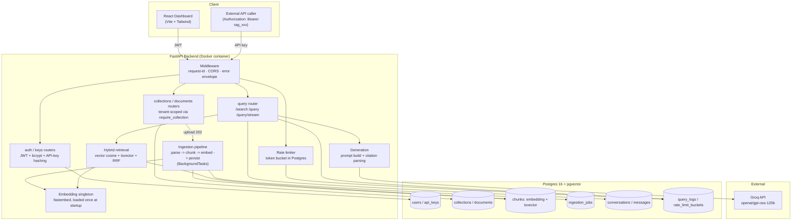

# RAG Pipeline as a Service

A multi-tenant RAG API: sign up, get an API key, create a collection, upload documents,
and query them with streamed, cited answers. The product surface is the service layer —
multi-tenancy, async ingestion with live progress, hybrid retrieval (vector + keyword,
fused with Reciprocal Rank Fusion), SSE streaming, per-key rate limiting, and per-request
observability — not just "call an LLM with some context."

## Stack

| Layer | Choice |
|---|---|
| Backend | Python 3.11, FastAPI, Pydantic v2, SQLAlchemy 2.0 (async), Alembic, uvicorn |
| Database | Postgres 16 + pgvector (local: docker-compose, prod: Neon) |
| Embeddings | fastembed, `BAAI/bge-small-en-v1.5`, 384-dim, local ONNX (no API, no torch) |
| LLM | Groq, `openai/gpt-oss-120b`, streaming (see note below) |
| Keyword search | Postgres `tsvector` + GIN (no Elasticsearch) |
| Fusion | Reciprocal Rank Fusion, hand-implemented |
| Parsing | pypdf, python-docx, markdown-it-py, BeautifulSoup4 |
| Frontend | React 18, Vite, TypeScript, Tailwind, shadcn/ui-style components |
| Tests | pytest, pytest-asyncio, httpx |

## Architecture



## Local setup (Windows / PowerShell)

Prerequisites: Docker Desktop (with WSL2), a free [Groq API key](https://console.groq.com).

```powershell
cd rag-service
Copy-Item backend\.env.example backend\.env
# edit backend\.env and set GROQ_API_KEY=gsk_...
docker compose up --build
```

Verify:
```powershell
Invoke-RestMethod http://localhost:8000/health
```
Expected: `{"status":"ok","db":"ok","embedding_model":"BAAI/bge-small-en-v1.5","version":"0.1.0"}`

Frontend:
```powershell
cd frontend
Copy-Item .env.example .env
npm install
npm run dev
```
Open http://localhost:5173.

## Running tests

Needs the `db` service from docker-compose running (`docker compose up -d db`).

```powershell
cd backend
python -m venv .venv
.venv\Scripts\pip install -r requirements.txt
.venv\Scripts\python -m pytest -q
```

The prompt-injection test additionally needs `GROQ_API_KEY` set (it makes a real LLM
call — there's no way to verify actual model behavior against a mock) and is skipped
otherwise. Everything else needs only Postgres.

## Evaluation results

`eval/run_eval.py` ingests `eval/corpus/` (4 short reference documents covering
astronomy, computing history, cell biology, and world geography) through the real
HTTP API, then runs all 30 questions in `eval/golden_set.json` against three retrieval
configurations, measuring recall@5, MRR, and mean retrieval latency. No LLM call is
involved. Real numbers, measured against the local docker-compose stack:

| Config | Recall@5 | MRR | Mean Latency (ms) |
|---|---:|---:|---:|
| vector-only | 100.00% | 0.967 | 95.5 |
| keyword-only | 70.00% | 0.700 | 117.7 |
| **hybrid+RRF** | **100.00%** | **1.000** | 120.0 |

Hybrid+RRF matches vector-only's recall and strictly improves its MRR (1.000 vs
0.967), while decisively beating keyword-only on both metrics. The improvement over
vector-only is concentrated in the golden set's "warranty code" questions
(`eval/corpus/computing_history.md`): four near-duplicate product records that differ
only in an opaque alphanumeric code (`QZR-88291` … `QZR-88294`). Dense embeddings
struggle to discriminate these — vector-only sometimes ranks the *wrong* code's
record first — while exact keyword matching on the literal code string is
unambiguous. RRF fusion combines both signals and consistently promotes the correct
record to rank 1. This is exactly the class of query hybrid retrieval exists for: it
never makes vector search worse, and it recovers cases vector search alone gets wrong.

Reproduce it yourself:
```powershell
cd backend
.venv\Scripts\python eval\run_eval.py
```

## API reference

All responses use the envelope `{"error": {"code", "message", "request_id"}}` on
failure. Collections/documents/query routes accept either `Authorization: Bearer
rag_<key>` or a dashboard JWT.

| Method | Path | Auth | Description |
|---|---|---|---|
| GET | `/health` | none | Service/DB/model status |
| POST | `/auth/signup` | none | Create a user, returns JWT |
| POST | `/auth/login` | none | Returns JWT |
| GET | `/auth/me` | JWT | Current user |
| POST | `/keys` | JWT | Create an API key (full key shown once) |
| GET | `/keys` | JWT | List keys (prefix only) |
| DELETE | `/keys/{id}` | JWT | Revoke a key |
| POST | `/collections` | JWT or key | Create a collection |
| GET | `/collections` | JWT or key | List your collections |
| GET/PATCH/DELETE | `/collections/{id}` | JWT or key | Get/update/delete |
| POST | `/collections/{id}/documents` | JWT or key | Upload a file (multipart), 202 |
| POST | `/collections/{id}/documents/url` | JWT or key | Ingest from a URL, 202 |
| GET | `/collections/{id}/documents` | JWT or key | List documents |
| DELETE | `/documents/{id}` | JWT or key | Delete a document |
| GET | `/jobs/{job_id}` | JWT or key | Ingestion job status |
| GET | `/collections/{id}/search` | JWT or key | Raw retrieval, no LLM (`mode=hybrid\|vector\|keyword`) |
| POST | `/collections/{id}/query` | JWT or key | Retrieval + generation, JSON response |
| POST | `/collections/{id}/query/stream` | JWT or key | Same, as SSE (`token`/`citations`/`done`/`error`) |
| GET | `/usage` | JWT or key | Per-key totals: queries, tokens, docs, chunks |
| GET | `/logs` | JWT or key | Recent query traces for your key |

## Notable design decisions

- **LLM model substitution.** The original spec named `llama-3.3-70b-versatile`. That
  model has since been removed from Groq's API (`404 model_not_found` when called
  live) and is not in this account's `/v1/models` list at all. `openai/gpt-oss-120b`
  — a 120B open-weight model Groq hosts with the same streaming chat-completions
  interface — is the closest available like-for-like substitute. It's set as the
  default in `app/config.py` and overridable via `GROQ_MODEL` if Groq's lineup
  changes again. Verified live: generation, citations, streaming, and multi-turn
  condensation all work correctly against it.
- **Citation marker parsing is bracket-style-defensive.** `openai/gpt-oss-120b`
  occasionally emits citation markers as full-width `【1】` instead of the
  instructed ASCII `[1]`. The system prompt explicitly demands ASCII brackets, and
  the citation-extraction regex additionally accepts both styles so a citation is
  never silently dropped over model formatting variance.
- **Hidden dashboard API key.** Collections/documents/query routes accept a JWT so the
  dashboard doesn't need a separate key, but `query_logs`/`conversations` are
  FK'd to `api_keys` per the fixed schema. Each user gets one hidden, non-listable
  API key (name `__dashboard__`, never returned as a usable secret) created lazily on
  first JWT-authenticated call to these routes, used purely as an attribution anchor.
- **`rate_limit_buckets` (10th table).** The 9-table schema doesn't have a home for
  token-bucket state; this table holds it, persisted in Postgres (not in-process
  memory) so limits are correct across replicas.
- **In-memory background ingestion.** Uploaded bytes are read once (needed anyway for
  SHA-256 idempotency) and handed directly to a `BackgroundTasks` coroutine — no disk
  or object storage in the stack, so nothing is written to disk between upload and
  ingestion.
- **Local test runner uses `NullPool`.** asyncpg connections are bound to the event
  loop that created them; pytest-asyncio's per-test loops conflict with a
  process-lifetime pooled engine on Windows. Set via `TESTING=1` (tests only);
  production keeps normal pooling.

## Deployment

See [DEPLOYMENT.md](DEPLOYMENT.md) for the full Render + Neon + Vercel walkthrough,
including Render free-tier memory notes and a cron-job.org keep-alive setup.
